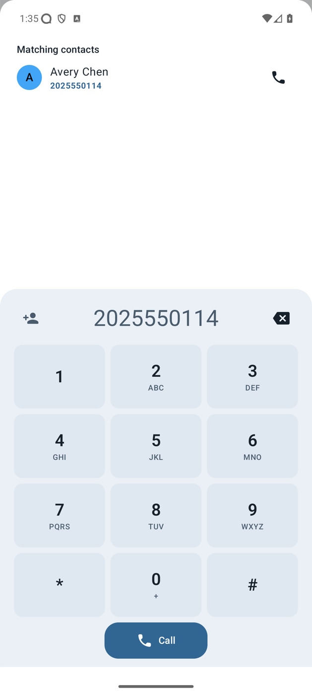
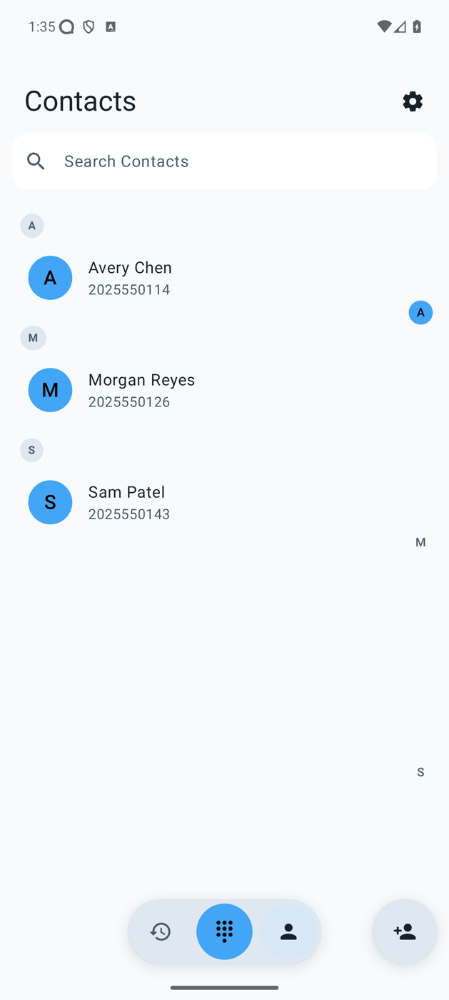

# Heimdall

Heimdall is an Android dialer based on [Koler](https://github.com/Chooloo/koler). It brings the dial pad, call history, and contacts together in a single app.

  

## Install and use

Heimdall runs on Android 10 or later and installs alongside Koler under the app ID `io.github.biowulf21.heimdall`. Install a signed APK and choose **Heimdall** when Android asks for the default Phone app. You can also change this under **Settings → Apps → Default apps → Phone app**.

Use the dial pad to enter a number. Open **Recents** to return a call or **Contacts** to find and edit entries. In Heimdall’s settings, you can choose a default screen, change the accent color, enable left-handed mode, and manage blocked numbers.

## Privacy

Heimdall uses Android’s local contacts and call history. It has no analytics or crash-reporting SDK and requests no internet permission. Links open in your browser. Calling and messaging actions use the Android services and apps you choose.

## Build

Install JDK 21 and Android SDK 37, then run `./gradlew :koler:assembleRelease`. Gradle writes the APK under `koler/build/outputs/apk/release/`. Sign the APK before sideloading. To update an installation, use the same signing key as the installed build.

## Support and credits

[Buy me a coffee](https://buymeacoffee.com/biowulf21), or open **Settings → About → Donate** in Heimdall. Report fork-specific issues on this repository’s Issues page.

Heimdall builds on Chooloo’s [Koler](https://github.com/Chooloo/koler). You can also [support Koler directly](https://paypal.me/theroeiedri).

## License

[GNU General Public License v3 or later](LICENSE). See [NOTICE](NOTICE) for the original Koler copyright and license notice.
