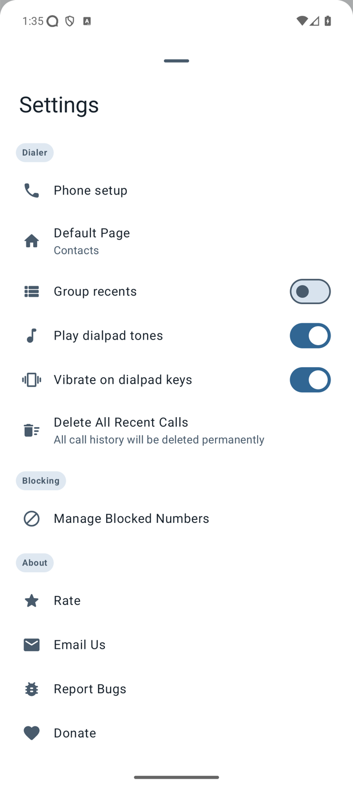

# Heimdall

Heimdall is an Android dialer based on [Koler](https://github.com/Chooloo/koler). It brings the dial pad, call history, and contacts together in a single app.

  

## Install and use

Heimdall runs on Android 10 or later and installs alongside Koler under the app ID `io.github.biowulf21.heimdall`. Install a signed APK and choose **Heimdall** when Android asks for the default Phone app. You can also change this under **Settings → Apps → Default apps → Phone app**.

Use the dial pad to enter a number. Open **Recents** to return a call or **Contacts** to find and edit entries. In Heimdall’s settings, you can choose a default screen, change the accent color, enable left-handed mode, and manage blocked numbers.

## Privacy

Heimdall uses Android’s local contacts and call history. It has no analytics or crash-reporting SDK and requests no internet permission. Links open in your browser. Calling and messaging actions use the Android services and apps you choose.

## Build

Install JDK 21 and Android SDK 37, then run `./gradlew :koler:assembleRelease`. Gradle writes the APK under `koler/build/outputs/apk/release/`. Sign the APK before sideloading. To update an installation, use the same signing key as the installed build.

## Fork and attribution

Heimdall is a fork of [Koler](https://github.com/Chooloo/koler) by Roei Edri
(Chooloo), licensed GPL-3.0-or-later. It uses its own name, icon and app ID and is
not affiliated with or endorsed by Chooloo. The original Koler copyright notice is
kept in [NOTICE](NOTICE).

Koler's *Classic* style bundles Google Sans font files inherited from upstream
(`chooloolib/src/main/res/font/`). They are not openly licensed, so they will be
removed or replaced before any store release (see [PRD.md](PRD.md)). The default
Expressive style uses the system font.

Report fork-specific issues on this repository’s Issues page.

## Donations

Heimdall is free and will stay free: no ads, no paid tier, no in-app purchases. If it
helps you, you can [buy me a coffee](https://buymeacoffee.com/biowulf21) or open **Settings → About → Donate**.
Donations are optional, unlock nothing, and don't buy support or a warranty. You can also [support Koler directly](https://paypal.me/theroeiedri).

## Documentation

[PRD.md](PRD.md) · [PRODUCT.md](PRODUCT.md) · [SCHEMA.md](SCHEMA.md) ·
[DESIGN.md](DESIGN.md) (the design language shared by all of Biowulf21's apps)

## License

[GNU General Public License v3 or later](LICENSE). See [NOTICE](NOTICE) for the
original Koler copyright and license notice.
