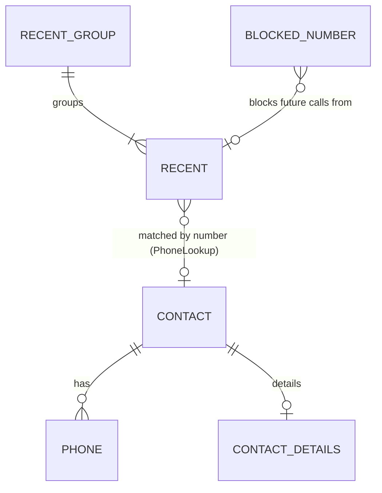

# Heimdall Data Schema

**Source of truth:** `chooloolib/src/main/java/com/chooloo/www/chooloolib/domain/model/`
and `.../data/repository/`
**App ID:** `io.github.biowulf21.heimdall`

Heimdall has **no database of its own**. Every call, contact and block lives in
Android's system providers; Heimdall reads and writes them through repositories
and keeps only its settings in a Jetpack DataStore. This document maps the models
to those providers.

## 1. Data ownership

| Store | Owner | Accessed by | Heimdall access |
|---|---|---|---|
| `ContactsContract` (contacts, raw contacts, data rows) | Android / sync accounts | `ContactRepositoryImpl`, `PhoneRepositoryImpl` | Read, create, edit, delete (`READ_CONTACTS`, `WRITE_CONTACTS`) |
| `CallLog.Calls` | Android | `RecentRepositoryImpl` | Read, delete (`READ_CALL_LOG`, `WRITE_CALL_LOG`) |
| `BlockedNumberContract` | Android | `BlockedRepositoryImpl` | Read, add, remove (default dialer only) |
| `Telecom` / `InCallService` | Android | `TelecomRepositoryImpl`, `AudioRepositoryImpl` | Place, answer, end calls; route audio |
| DataStore Preferences | Heimdall | `PreferenceRepositoryImpl` | Read/write settings |

Deleting a contact deletes it from its sync account too; the UI says so before
confirming.

## 2. ERD (logical)

## 3. Model catalog

| Model | Key | Fields | Provider mapping |
|---|---|---|---|
| `Contact` | `id` (contact id) | `name`, `photoUri`, `number`, `isFavorite` (starred), `lookupKey`, `customRingtone`, `sendsToVoicemail` | `ContactsContract.Contacts` |
| `ContactDetails` | contact id | `phones`, `emails`, `organization`, `whatsappNumber` | `ContactsContract.Data` rows |
| `Phone` | data row id | number, type, label | `CommonDataKinds.Phone` |
| `PhoneLookup` | `contactId` | `name`, `label`, `type`, `photoUri` | `PhoneLookup` by number |
| `Recent` | `id` (call log id) | `number`, `dateMillis`, `type` (`RecentType`), `durationSeconds`, `name`, `photoUri`, `numberType`, `numberLabel`, `presentation` | `CallLog.Calls` |
| `RecentGroup` | — | consecutive `Recent`s from one number; `latest` | Derived in memory when **Group recents** is on |
| `DialpadContact`, `PhoneKeyLetters` | — | T9 matching helpers | Derived in memory |

Enums: `Page` (`DIALER`, `CONTACTS`, `RECENTS`); `RecentType` (`INCOMING`,
`OUTGOING`, `MISSED`, `VOICEMAIL`, `REJECTED`, `BLOCKED`, `UNKNOWN`);
`ThemeMode` (`SYSTEM`, `LIGHT`, `DARK`); `DesignStyle` (`EXPRESSIVE`, `CLASSIC`).

## 4. Settings (DataStore)

| Key | Type | Default | Meaning |
|---|---|---|---|
| `default_page` | string (`Page`) | `CONTACTS` | Screen shown on launch |
| `theme_mode` | string (`ThemeMode`) | `SYSTEM` | Light/dark |
| `accent_rgb` | int | `0x42A5F5` | Accent for the design system |
| `design_style` | string (`DesignStyle`) | `EXPRESSIVE` | Shared design or Koler's classic look |
| `group_recents` | boolean | `false` | Group consecutive calls |
| `dialpad_tones` | boolean | `true` | DTMF tones on key press |
| `dialpad_vibrate` | boolean | `true` | Haptic on key press |
| `left_handed` | boolean | `false` | Mirror one-handed controls |
| `circular_letter_preview` | boolean | `false` | Circle vs squircle letter avatars |
| `phone_setup_completed` | boolean | `false` | Default-dialer setup finished |

## 5. Invariants

- No internet permission; nothing leaves the device except calls the user places.
- No local copy of contacts or call history: always query the providers.
- Durations are seconds (`durationSeconds`); timestamps are epoch milliseconds.
- Adding a setting means adding a DataStore key, a `Settings` field with a default,
  and a row in the table above.
